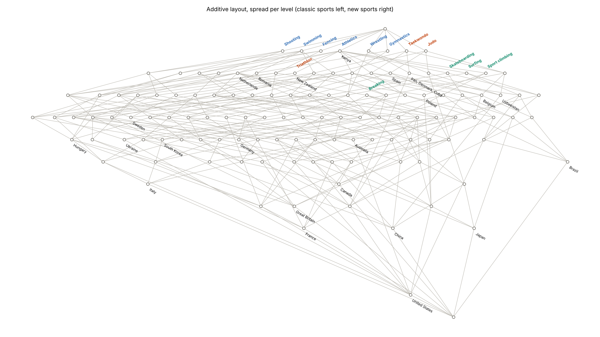
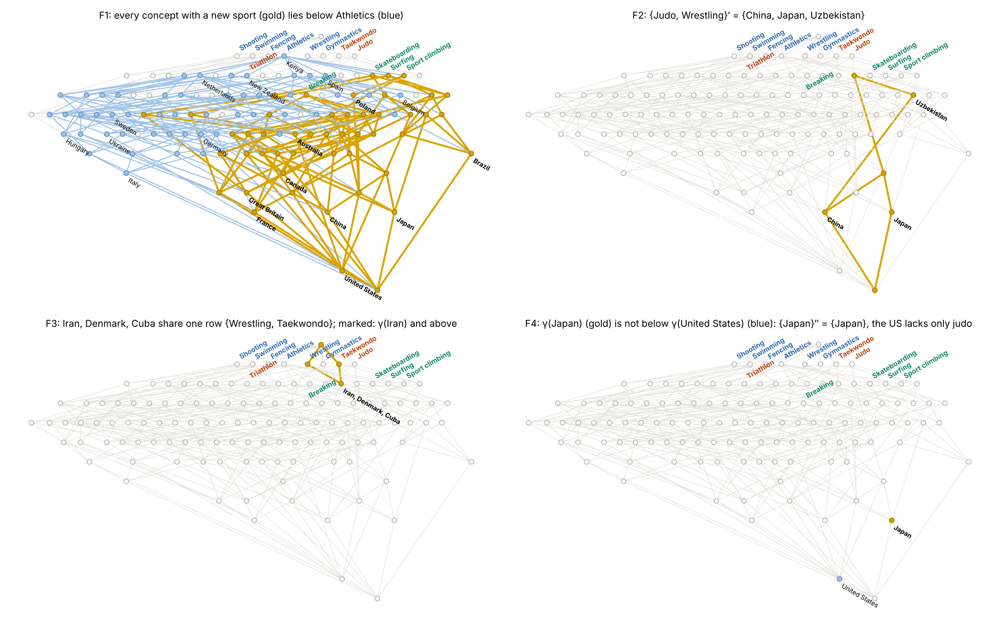
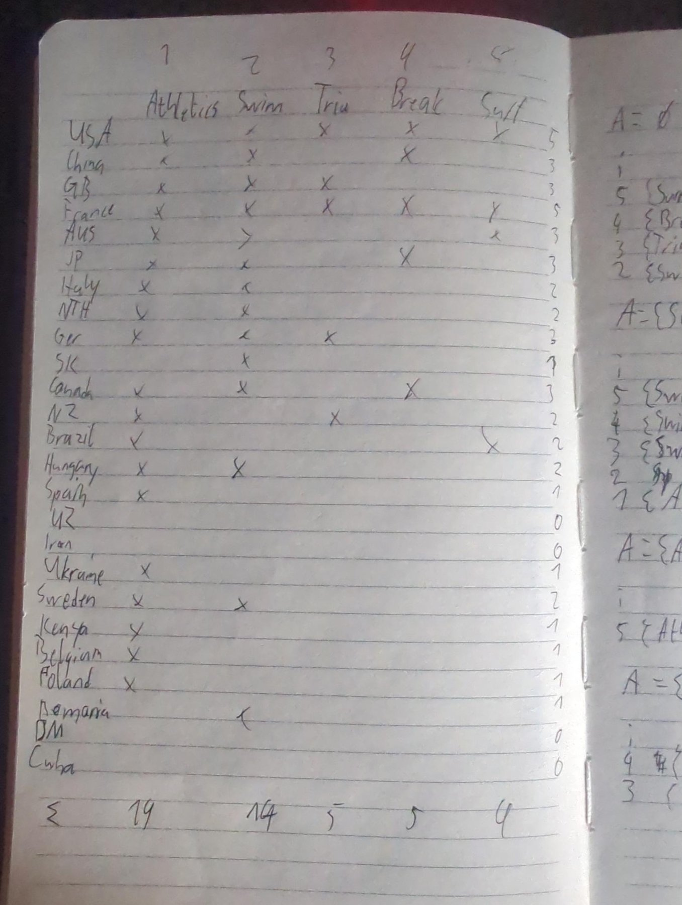
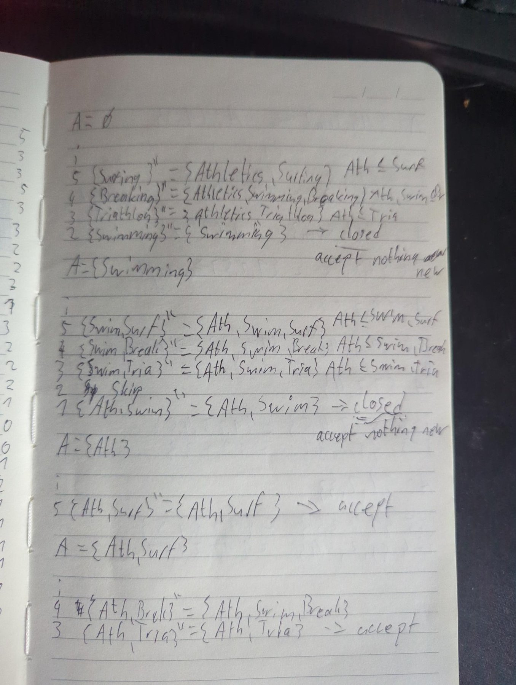
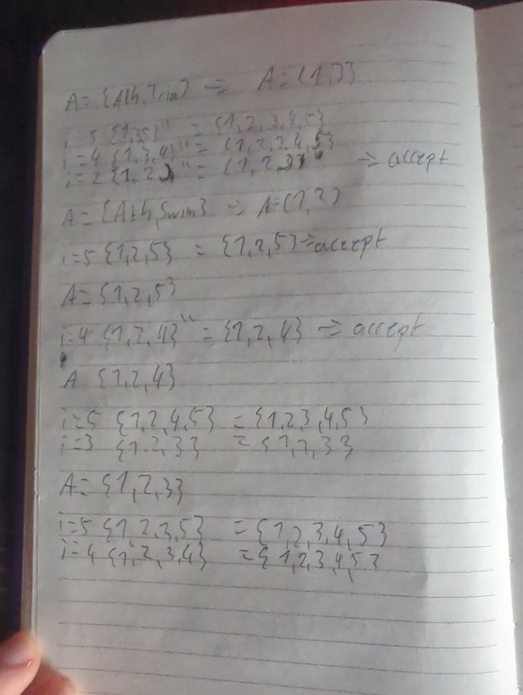
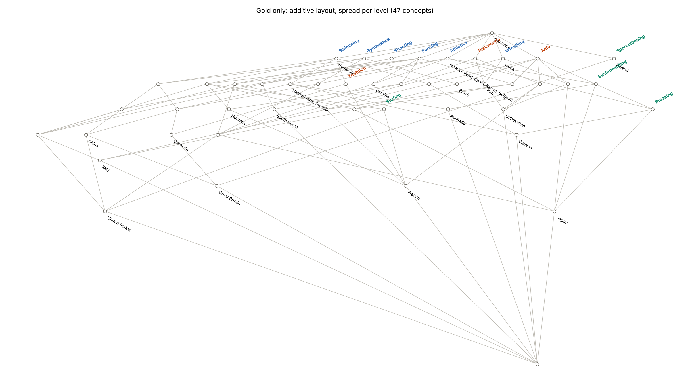
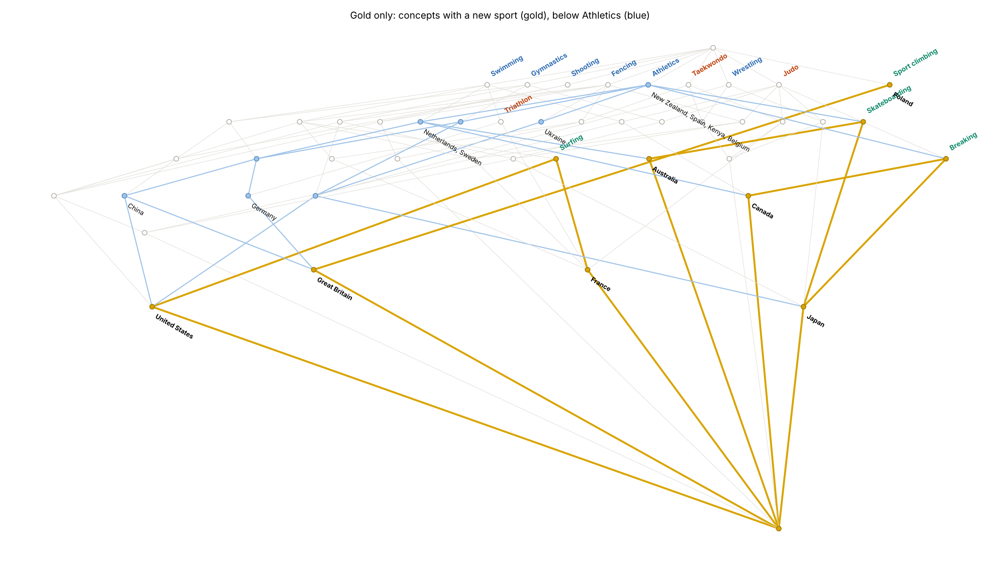

# Beyond the Medal Table – Paris 2024 through Formal Concept Analysis

*Merlin Moller · Conceptual Data Analysis – Python Lab, Sheet 1 · Universität Kassel · WiSe 2026/27*

**Question.** Which nations share the same sporting strengths at Paris 2024, and what do these groups reveal that a single ranking cannot?

**Data.** Per-sport medal tables from English Wikipedia (*List of 2024 Summer Olympics medal winners*; volleyball from Olympedia), downloaded 24.11.2026. Checked: per-nation sums equal the official medal table, column sums are 329 gold / 330 silver / 385 bronze. Tools: Python `concepts`, `pandas`, Graphviz, matplotlib; code and all figures in the repository.

## 1. From results to a cross table

**Context.** K = (G, M, I) with G = the 25 nations with the most medals (no tie at the cut: ranks 23–25 have 9 medals, the next nations 8), M = 13 sports, and *g I m* ⇔ nation *g* won at least one medal in sport *m*.

**Choice of sports.** The 13 sports form three generations of the Olympic programme: *since 1896* – athletics, swimming, wrestling, fencing, gymnastics, shooting; *added 1964/2000* – judo (Japan), taekwondo (Korea), triathlon; *added 2020/2024* – breaking, skateboarding, sport climbing, surfing. A first selection of 14 broad sports (cycling, rowing, canoeing, boxing, …) gave 269 concepts and an unreadable diagram (Fig. 01); the generation design keeps the diagram manageable (125 concepts) and gives the analysis a theme the medal table does not have. Judo and taekwondo are grouped by *origin*, not by who wins them – grouping by dominance would be circular. Rowing was left out because it entered only in 1900; team sports and further individual sports were left out to keep the lattice readable.

**Shape of the table.** 120 of 325 cells are crossed (**36.9 %**). The nation with medals in the most sports is the **United States** (12 of 13, all but judo); the sport with the most nations is **athletics** (19 of 25). At the other end, Kenya medals only in athletics, and Iran, Denmark, Cuba and Romania in two sports each.

**What is lost.** A cross records *whether*, not *how much*. The US won 28 swimming medals, Romania 2 – same cross. Iran won 12 medals in wrestling and taekwondo, Denmark 2 – yet both rows are identical (see §5).

## 2. Asking the data questions

| | Question | Formula | Answer |
|---|---|---|---|
| (a) | Nations with medals in both swimming and judo | {Swimming, Judo}′ | {China, France, Japan, Italy, Germany, South Korea, Canada, Sweden} |
| (b) | Sports in which every swimming nation medals | {Swimming}″ | {Swimming}′ = 14 nations; {Swimming}″ = **{Swimming}** |
| (c) | Nations that medal in every sport Ukraine medals in | {Ukraine}″ | {Ukraine}′ = {Athletics, Wrestling, Fencing, Gymnastics, Shooting}; {Ukraine}″ = **{United States, Ukraine}** |

In (b) the derivation is an *intersection*: the 14 swimming nations together cover all 13 sports, but no sport other than swimming is shared by all of them (Romania has no athletics medal, South Korea none either).

**"Closed" for a sports journalist.** A set of sports is closed if winning medals in all of them tells you nothing more. Swimming and judo are closed: their medal nations have no other sport in common. Breaking is not: every nation that won a breaking medal in Paris (US, China, France, Japan, Canada) also won medals in athletics and swimming – {Breaking}″ = {Athletics, Swimming, Breaking}.

## 3. Finding all strength profiles

The lattice has **125 concepts**, against the upper bound 2^|M| = 2^13 = 8192 (1.5 %).

**NextClosure by hand** (Appendix A) on five sports ordered 1 Athletics < 2 Swimming < 3 Triathlon < 4 Breaking < 5 Surfing. The candidate for *i* is ((A ∩ {1,…,i−1}) ∪ {i})″; it is accepted if no new element smaller than *i* appears.

1. A = ∅″ = ∅. *i* = 5: {5}″ = {1,5} – 1 is new and < 5, reject. *i* = 4: {4}″ = {1,2,4} – reject. *i* = 3: {3}″ = {1,3} – reject. *i* = 2: {2}″ = {2} – accept → **{Swimming}**.
2. A = {2}. *i* = 5, 4, 3: {2,5}″ = {1,2,5}, {2,4}″ = {1,2,4}, {2,3}″ = {1,2,3} – each adds 1, reject. *i* = 2 ∈ A, skip. *i* = 1: ({2} ∩ ∅) ∪ {1} = {1}, {1}″ = {1} – accept → **{Athletics}** (swimming drops out, like a carry in binary counting).
3. A = {1}. *i* = 5: {1,5}″ = {1,5} – accept → **{Athletics, Surfing}**.

| # | Intent | Extent | # | Intent | Extent |
|---|---|---|---|---|---|
| 1 | ∅ | 25 | 6 | {Ath, Swim} | 12 |
| 2 | {Swim} | 14 | 7 | {Ath, Swim, Surf} | 3 |
| 3 | {Ath} | 19 | 8 | {Ath, Swim, Break} | 5 |
| 4 | {Ath, Surf} | 4 | 9 | {Ath, Swim, Tria} | 4 |
| 5 | {Ath, Tria} | 5 | 10 | {Ath, Swim, Tria, Break, Surf} | 2 |

10 of 32 possible intents; the result matches `next_closure(..., trace=True)`.

**2^n concepts.** The contranominal scale (S, S, ≠) – every object has every attribute except "its own" – makes every attribute set closed and reaches 2^n. Sports data stays far below because (i) 25 nations cannot realise 8192 profiles and (ii) the sports are correlated: big nations medal almost everywhere, small ones in few sports, and new sports occur only together with athletics. Small sub-contexts can reach the bound: fencing, gymnastics, judo, taekwondo and breaking give all 2^5 = 32 concepts.

## 4. Reading the picture

The line diagram (Fig. 04, interactive version 05) uses reduced labelling and an additive layout: height = number of sports, classic sports pull left, new sports right.

1. **Subordination.** μ(Breaking) lies below μ(Athletics) and μ(Swimming); μ(Skateboarding), μ(Sport climbing), μ(Surfing) and μ(Triathlon) lie below μ(Athletics). Every nation with a medal in a new sport also has one in athletics (F1).
2. **Incomparable.** μ(Judo) and μ(Taekwondo) are incomparable: neither sport implies the other (12 and 14 nations, 8 in common). This is the rule, not the exception – 72 of the 78 pairs of sports are incomparable.
3. **The top 5 of the medal table.** The United States sit near the bottom (12 sports), France, China and Japan in the middle (9 each), Australia high up (5 sports). Rank in the medal table and breadth of the profile are different things; γ(Japan) is not below γ(United States) because the US has no judo medal (F4).

## 5. Removing what is redundant

**Clarification.** Iran, Denmark and Cuba have identical rows {Wrestling, Taekwondo} – *medal twins*, although they won 12, 9 and 9 medals in total. No two sports have identical columns.

**Reducible sports: none.** No sport's column is the intersection of other columns, so every sport is the top of its own concept – each one adds structure that the others cannot produce. Among nations, after clarification, six rows are intersections of other rows (Netherlands, Hungary, Spain, Iran, Kenya, Belgium). Kenya, for example, has only athletics, exactly what all athletics nations share, so γ(Kenya) = μ(Athletics) and Kenya creates no concept of its own.

**Same shape.** The reduced context (17 nations × 13 sports) has again 125 concepts; its lattice is isomorphic to the original.

## 6. Answer

| # | Finding | Concept | Gold only? |
|---|---|---|---|
| F1 | **New sports are won by athletics nations.** Only 9 of 25 nations medal in breaking, skateboarding, climbing or surfing – all of them also in athletics. | μ(new sport) ≤ μ(Athletics) | **Partly.** Breaking and skateboarding still imply athletics; climbing (Poland, GB) and surfing do not (Fig. 10). |
| F2 | **Judo + wrestling is an East-Asian/Central-Asian profile.** | ({China, Japan, Uzbekistan}, {Judo, Wrestling}) | **Yes.** {Japan, Uzbekistan}. |
| F3 | **Medal twins.** Iran (rank 17 by medals), Denmark (24) and Cuba (25) share one profile: wrestling and taekwondo only. | γ(Iran) = ({US, China, Uzbekistan, Iran, Denmark, Cuba}, {Wrestling, Taekwondo}) | **No.** Denmark has no gold in these sports, Cuba only in wrestling – it is a *medal*, not a *gold* profile. |
| F4 | **Japan's profile is unique.** No other nation, not even the US, medals in all of Japan's nine sports – the US lacks exactly judo. | {Japan}″ = {Japan} | **Yes.** {Japan}″ = {Japan} also with gold only. |

**What the medal table cannot show.** The medal table ranks nations on one number. The lattice shows *how* nations are strong: Iran, Denmark and Cuba are far apart in the ranking but identical in profile (F3); the newest Olympic sports are not a door for new nations but are won by those that already medal in athletics (F1); and the number one of the medal table does not dominate everyone – Japan's profile is not covered by the US (F4). F2 and F4 survive the gold-only test; F1 holds only for breaking and skateboarding; F3 is an artefact of counting bronze and silver – itself a finding about what kind of strength these nations have.

---

## Appendix

**A. NextClosure by hand** – `handrechnung/` (photos of the sub-context and the computation; printable sub-context `subcontext.pdf`).

**B. Cross table** – `olympics.cxt` (full), `olympics_gold.cxt` (gold only).

**C. Diagram history** – `figures/README.md`: 01 Graphviz with 14 placeholder sports (269 concepts) → 02 Graphviz, final 13 sports → 03 pure additive layout → 04 additive, spread per level → 05 interactive HTML.

**D. Gold-only lattice** – `figures/04_additive_spread_gold.pdf` (47 concepts, 72 crosses = 22.2 %), `figures/10_gold_new_sports.png`.

**E. Findings, full size** – `figures/06`–`09`.

**F. AI use** – `AI_LOG.md`.

### A. NextClosure by hand

### D. Gold-only lattice

